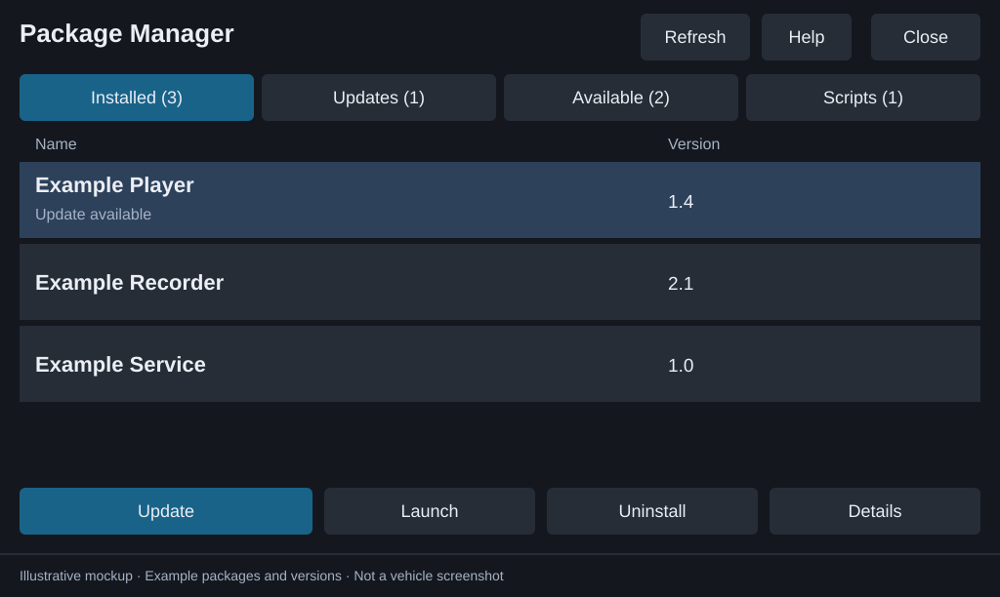

# Package Manager

Browse and install NEMESIS community packages from one USB drive on a compatible Gen5W head unit. Package Manager uses NEMESIS to install, update, launch, and uninstall packages; it does not replace NEMESIS Manager.

**Requires NEMESIS already installed.** Development prereleases are experimental and debug signed. Check each community package's vehicle and firmware requirements before installing it.

*Screen mockup with example packages and versions. See the [illustrated user guide](docs/USER-GUIDE.md) for the full walkthrough.*

## What the two apps help you do

Keep community releases together on one USB drive, prepare them on your computer, and choose what to install or run from the head unit. See what is on the drive, what is installed, and which USB releases are newer without rebuilding the drive around a single package.

| App | Where you use it | What it helps with |
| --- | --- | --- |
| **Package Manager** | The vehicle's head unit, with NEMESIS already installed | Browse installed packages and USB releases in one place; compare versions; confirm installs, updates, and scripts; launch or uninstall supported packages; inspect results and history. |
| **USB companion** | A local browser window on a Windows or Linux computer | Set up the package drive, import downloaded releases into package folders, inspect installer versions and layout errors, and replace installers while preserving each folder's USB `data/`. Standalone downloads include the runtime. |

Copying a release onto USB is preparation; installation happens on the head unit after you confirm it. You can also prepare the drive manually or with the optional Python tools.

Neither app downloads community releases automatically or decides vehicle compatibility. The companion shows versions **on USB**; Package Manager also reads installed versions from the head unit.

## Firmware compatibility and tested vehicles

Package Manager targets **Android-based Gen5W head units with `S5W_M` in the software version**, with **NEMESIS already installed and working**. Find the software version under **General Settings > SW Info**. Upstream NEMESIS requires OTA update capability, although an active OTA subscription is not required; `S5W_L` head units are unsupported. Follow the [NEMESIS compatibility check](https://github.com/xwtk/hmg_nemesis#compatibility-check) for its full requirements and exclusions.

The following is the only vehicle and firmware combination currently reported as tested with Package Manager:

| Vehicle | Model year | Firmware version |
| --- | --- | --- |
| Hyundai IONIQ 5 | 2023 | `260507` |

No broader Package Manager firmware version range has been verified. Other vehicles, model years, regional firmware variants, and firmware builds remain unverified; a matching firmware number on another vehicle does not establish compatibility. Each community package also has its own compatibility requirements.

## Get started

1. **Download on your computer.** Get the USB companion for your computer, `usb-package-manager-ready.zip`, and the community releases you want from their release pages. The manager and companion are on the [releases page](https://github.com/hmason55/nemesis-package-manager/releases).
2. **Prepare your USB drive.** In the companion, select the drive. Use **Drive setup** to add Package Manager, then **Add package** to copy your downloaded releases.
3. **Install in the parked vehicle.** With the head unit fully booted, insert USB and approve the NEMESIS execution prompt. Package Manager opens. Tap **Refresh**, choose **Available**, select a package, and confirm **Install**.
4. **Wait for the result.** Keep USB connected until the result popup. Your installed package is then listed in **Installed**.

After first setup, reopen through **NEMESIS Manager > Packages > Package Manager > Launch**. Follow the [illustrated user guide](docs/USER-GUIDE.md#get-started) for each screen, or [Windows setup](docs/SETUP-WINDOWS.md) to prepare files manually.

## Local USB companion

Download the Windows or Linux x86-64 companion from the [releases page](https://github.com/hmason55/nemesis-package-manager/releases), extract it, and run it. No Python or Node installation is needed. It opens a local browser UI for drive setup and package imports. See [downloads and instructions](docs/USB-COMPANION.md#run-a-release-download).

## Everyday use

Start in **Installed**, or choose **Updates**, **Available**, or **Scripts**. Select a row to see its actions. Keep USB connected until the result popup, and finish one operation before starting another in either manager UI. The [user guide](docs/USER-GUIDE.md#find-your-way-around) explains each screen and action.

## Updates

- **Other packages:** replace the installer in the same `packages/<Name>/` folder, preserving `data/`. Open the app, Refresh, select the package, and confirm **Update**.
- **Package Manager:** use NEMESIS's installer with the new `usb.package.manager.zip`; see [the manager update steps](docs/UPDATING.md#update-package-manager). Package Manager is excluded from its own lists and actions.
- **Removal:** use NEMESIS Manager's Packages screen to uninstall Package Manager itself.

See the [illustrated update walkthrough](docs/USER-GUIDE.md#update-a-community-package) and [full update instructions](docs/UPDATING.md).

## User guides

| Guide | What you will find |
| --- | --- |
| [Illustrated user guide](docs/USER-GUIDE.md) | Getting started, tabs, actions, confirmation, progress, results, and troubleshooting |
| [USB companion](docs/USB-COMPANION.md) | Computer downloads, drive preparation, package imports, and recovery |
| [Windows setup](docs/SETUP-WINDOWS.md) | Manual setup and optional source-checkout tools |
| [Updating packages](docs/UPDATING.md) | Community updates, manager updates, version rules, and failures |
| [Release layouts](docs/RELEASE-LAYOUTS.md) | Where release files belong on USB |

## Before installing packages

Only install trusted releases: NEMESIS hooks and scripts run with root privileges. Package Manager does not resolve conflicts or guarantee firmware compatibility. Scripts that hard-code USB-root paths may need their author's adaptation before use in a nested folder. Keep existing recordings and backups when preparing your drive.

## Development

Successful builds on `main` publish development prereleases with change notes, provenance, and SHA-256 checksums. Stable publication requires an explicit version/commit selection and all quality and artifact checks. PR builds and ordinary manual checks do not publish. See [release procedures](docs/RELEASING.md). Artifact filenames retain their existing names for compatibility.

- [Build, tests, and releases](docs/BUILD-AND-TEST.md)
- [Detailed workflow diagrams (optional reference)](docs/WORKFLOW-REFERENCE.md)
- [Contribution and quality standards](CONTRIBUTING.md)
- [Code of conduct](CODE_OF_CONDUCT.md)
- [Report a security vulnerability privately](SECURITY.md)
- [NEMESIS documentation](https://github.com/xwtk/hmg_nemesis)

New contributors can start with the [development setup and first PR walkthrough](CONTRIBUTING.md#first-contribution). Documentation fixes and host-side tests do not require a vehicle. Use the [issue templates](https://github.com/hmason55/nemesis-package-manager/issues/new/choose) for bugs and feature requests.

## Credits

Package Manager is built on [NEMESIS](https://github.com/xwtk/hmg_nemesis/), developed by [xwtk](https://github.com/xwtk).

## License

GNU Affero General Public License, version 3. See [LICENSE](LICENSE).
