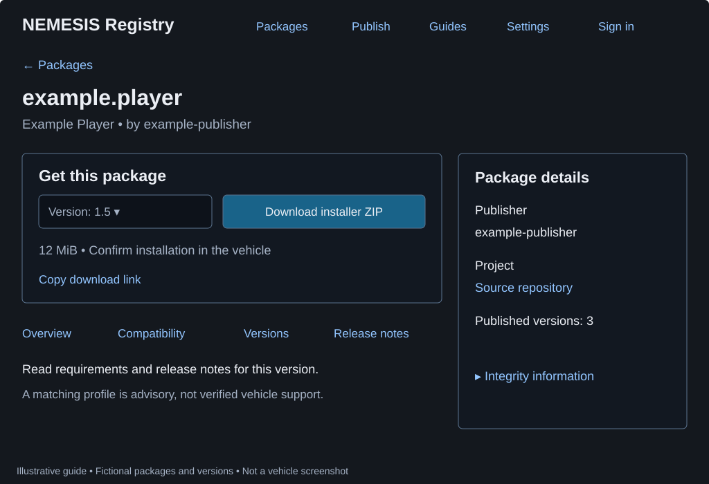
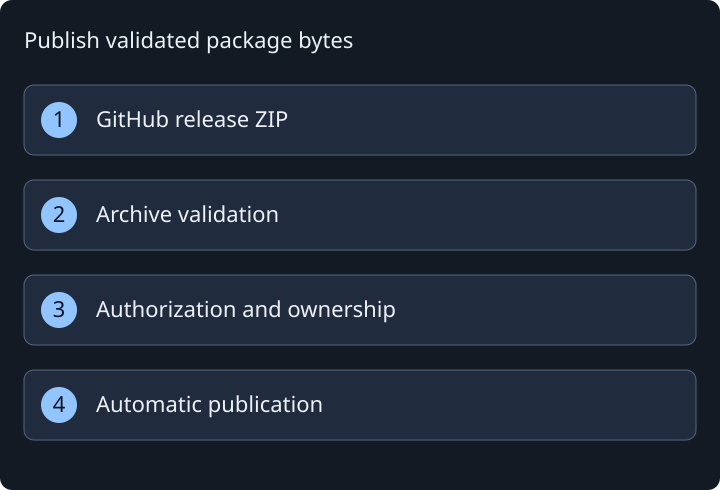

# Registry website guide

Use the [registry website](https://hmason55.github.io/nemesis-package-manager/) to find published community packages and choose a release. Browsing and downloads are public. GitHub sign-in is needed only to publish or manage packages.

The website, USB companion, and vehicle app use the same registry package IDs and release versions. A download prepares installer bytes; installation happens only after confirmation through NEMESIS in the vehicle. Current clients default to the staging service. See [deployment status](CLOUD-DEPLOYMENT.md) and [validation requirements](CLOUD-VALIDATION.md) for operational evidence.

## Find and download a release

1. Open **Packages** and type a package name, ID, or description. Search updates as you type. Expand **Filter results** to narrow by category, publisher, or maximum download size and choose a sort order.
2. Open a package and check its publisher, source repository, and package ID. Similar names do not establish matching identities.
3. Use **Version** to select the exact published release. Read **Overview**, **Compatibility**, **Versions**, and **Release notes**. The maximum-size filter applies to the latest published ZIP; inspect the selected version's size separately.
4. Choose **Download installer ZIP** for manual companion import, or find the same ID/version inside the companion's **Cloud registry** panel. The vehicle app can also browse **Cloud Registry** and download a selected release.
5. For a manual download, import it with **Add / update** in the companion, safely eject the drive, then choose **USB Storage** in the vehicle and confirm installation.

**Settings** stores appearance and optional device-profile preferences locally. A matching declaration is publisher information, not a hardware certification. Missing or conflicting compatibility information remains advisory. **Integrity information** shows SHA-256 for the selected version; it establishes a byte match, not code safety.

A withdrawn or unavailable version cannot be downloaded through the registry. Select another published version explicitly. Withdrawal cannot remove previously downloaded USB copies or uninstall a vehicle package.

## Publish from GitHub

1. Choose **Publish > Sign in with GitHub**. Use **Connect repository on GitHub** to install the App on the intended public repository, then return and register `owner/repository`. Your account needs write, maintain, or administrator permission. Sign-in survives navigation and reloads in the same tab until sign-out or the one-hour session expiry.
2. Build a directly installable ZIP with `NEMESIS.data` at its root or under one enclosing directory. Keep the package ID stable and set the exact release version in the manifest. USB wrapper bundles, source-code archives, standalone scripts, and the reserved `usb.package.manager` ID are not accepted here.
3. Publish a GitHub Release with the finished ZIP attached as a release asset. In **Publish**, select the registered repository, published release, and exact installer asset.
4. Enter the internal ID/version, name, and description. Expand **More package details** for categories, release notes, and compatibility declarations. Review the asset and acknowledge redistribution permission before submitting.
5. Follow **Waiting for validation → Validation in progress → Finishing publication → Published**. Successful trusted validation publishes automatically; there is no separate maintainer approval queue. If validation fails, read its report and correct the artifact before resubmitting.

For a custom icon, put an optional `icon.png` beside the package manifest **inside the installer ZIP**. Use a still, non-interlaced PNG no larger than 512 × 512 pixels and 256 KiB. Without artwork, the site uses the publisher avatar and a local fallback.

Validation reads the archive and checks paths, sizes, corruption, and exact identity without running package code. Published version bytes are immutable; changed bytes need a new version. Successful publication reserves the package ID for its repository. Administrators can withdraw releases or block abusive publishing.

See the [online publisher walkthrough](https://hmason55.github.io/nemesis-package-manager/#guides/publish) for onboarding and recovery, [supported layouts](RELEASE-LAYOUTS.md) for local USB formats, and [registry operation](CLOUD-REGISTRY.md) for deployment and validation details.

## Unpublish your packages

Sign in with the GitHub account that published the package and open **Publish > My published packages**. Choose **Unpublish package**, confirm the package ID and scope, and supply a reason. The registry withdraws all published versions and stops pending submissions for that package in its owning repository.

Publishers can remove only packages they have personally published successfully; registering or collaborating on a repository alone does not grant this right. The server also rechecks current GitHub publishing permissions and repository authorization. Maintainers retain **Manage registry > Remove package** for any package.

Unpublishing stops new registry downloads and icons. It does not delete GitHub releases, recall offline copies, uninstall vehicle packages, erase audit records, or release ownership of the package ID. Published versions remain immutable.

## Republish a withdrawn version

To restore a version you unpublished, open **Publish > My submissions**, find its **Withdrawn** row, and choose **Republish version**. Confirm the package ID/version and original ZIP/hash, then enter a reason. Current GitHub permissions, repository ownership, publishing blocks, and stored-artifact availability are checked again. Each restored version becomes downloadable under its original URL with the same SHA-256. Changed ZIP bytes require a new version.

Administrator withdrawals and older withdrawals without a recorded withdrawing publisher require administrator recovery. Open **Manage registry**, find the **Withdrawn** version, choose **Republish version**, confirm its identity and original artifact, and supply a reason. Missing artifacts, revoked repository authorization, and blocked accounts prevent restoration; resolve the cause before retrying. Republish restores one version at a time, including its icon, and does not resume stopped submissions or reinstall anything on vehicles.

## If something goes wrong

| What you see | Next step |
| --- | --- |
| No matching packages | Clear search and reset filters; check the selected registry and connection |
| Requested version unavailable | Choose an explicitly listed published version |
| Integrity or archive error | Obtain the intended release again; ask the publisher to correct invalid artifacts |
| Repository missing in Publish | Check public visibility, repository permissions, App installation, and release asset selection |
| Validation failed | Read the private validation report; fix the cause before retrying |
| Registry offline | Continue with downloaded ZIPs and USB; installed-package management remains available |
