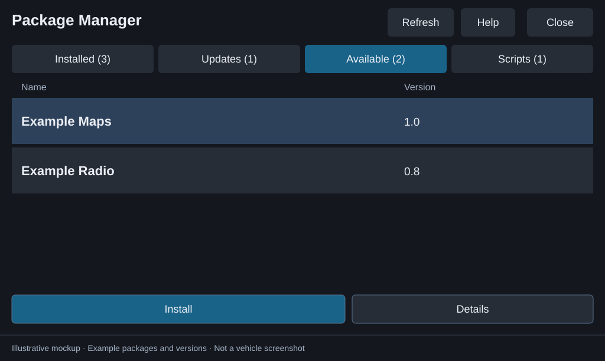

# Package Manager: Windows setup

For a walkthrough with screen examples, start with the [illustrated user guide](USER-GUIDE.md#get-started). The standalone [Windows USB companion](USB-COMPANION.md#run-a-release-download) can prepare the drive for you; the manual and optional command-line steps are below.

## A. Download

NEMESIS must already work on your head unit. Download `usb-package-manager-ready.zip` from a release. Alternatively, open **Actions > Build Package Manager**, download the successful run's `nemesis-usb-package-manager` artifact, and extract that wrapper first.

## B. Prepare the drive

Extract `usb-package-manager-ready.zip` onto a FAT32/exFAT drive recognized by the head unit. Keep `manager/usb.package.manager.zip` compressed. Put community releases under `packages/<Name>/`; follow [supported layouts](RELEASE-LAYOUTS.md).

Optional Python tools run from a source checkout:

```powershell
python tools/prepare_usb.py --usb E:\ --bundle .\usb-package-manager-ready.zip --add .\downloads\example-usb.zip
```

For later additions:

```powershell
python tools/import_release.py .\downloads\example-usb.zip --usb E:\ --name Example
```

The importer preserves existing data folders. Use `--overwrite` only to replace an existing release's installer files. Scripts that assume files are at the USB root may require their author's adaptation.

## C. First launch

With the vehicle parked and the head unit fully booted, insert the drive and approve the execution prompt. NEMESIS installs Package Manager if missing and opens it. By default, the launcher then backs up its own root descriptor as `NEMESIS.data.disabled`, so future startups do not prompt to execute the drive. Enabling **Run Package Manager when this USB is inserted** in companion **Settings** keeps launch active instead. Open **NEMESIS Manager > Packages > Package Manager > Launch** afterward.

Existing drives need the new launcher to run once for this change. It never replaces an existing disabled-descriptor backup or disables an unrelated install descriptor. If a backup already exists, a numbered backup is created instead. Reinserting the drive does not reinstall community packages.

Choose **USB Storage** at the startup source prompt and tap **Continue**. You can change the source later in **Settings**.

## D. Install and update packages

See [tabs and actions](USER-GUIDE.md#find-your-way-around) for screen examples, or follow the [update walkthrough](USER-GUIDE.md#update-a-community-package) to replace a release on USB and then install it in the vehicle.



*Screen mockup with example package data. Follow the [illustrated install walkthrough](USER-GUIDE.md#install-a-package) for confirmation, progress, and result screens.*

For the full update procedure, including replacing another package's installer, updating Package Manager itself, and handling failures, see [Updating packages](UPDATING.md).

Select a package and choose **Install**, **Update**, **Launch**, or **Uninstall**. Scripts use **Run script**. The spinner animates while work runs; NEMESIS does not provide a trustworthy percentage. Do not remove the drive during an operation. Confirmation buttons are separated to reduce accidental taps.

To update another app, import its new release into the same folder with `--overwrite`, preserving `data/`, then tap **Refresh**, select it, and choose **Update**. The Updates tab shows confirmed newer versions. Only confirmed newer releases appear in Updates. Each package ID has one browser row; multiple releases open a version picker. Equal, older, and locked versions retain their restrictions. Check **Details > Choose version** and the package's instructions when ordering is unknown.

Both manager UIs share installed packages. Wait for one operation to finish before starting another in either UI. Completion popups explain the result; their **Details** shows exit codes and output. Package Details contains full source and data/history paths.

## E. Update Package Manager itself

Package Manager is hidden from its own list and cannot manage itself. Follow [the manager update steps](UPDATING.md#update-package-manager) to prepare a separate drive with an install descriptor pointing to the new `usb.package.manager.zip`. Close Package Manager, confirm the update through NEMESIS, and wait for completion before reopening it through NEMESIS Manager.

You can still install or update directly through NEMESIS using a separate drive with an install descriptor pointing to `usb.package.manager.zip`. Remove Package Manager only through **NEMESIS Manager > Packages > Package Manager > Uninstall**. Its technical package ID remains `usb.package.manager`.

## Data and troubleshooting

- Uninstalling keeps installer files and `packages/<Name>/data/`. Other apps keep their own export locations unless configured separately.
- **Installed state unavailable:** check the displayed NEMESIS error, then Refresh. Package-changing actions stay disabled until the query succeeds.
- **Invalid installer:** select Details to inspect the descriptor/path error.
- **History could not be saved:** inspect the popup Details and check drive connectivity and write access.
- A recurring execution prompt means an active root descriptor remains. Check the companion Settings launch preference; if automatic launch is off, confirm that first-launch disabling succeeded.

Only run trusted packages. Hooks and scripts run as root. This manager does not resolve package conflicts or establish firmware compatibility. New update and launcher behavior still requires head-unit validation.

## Release channels

Automatic main-branch builds are experimental prereleases. Stable releases use an explicit maintainer publication after quality and artifact checks pass. See [release procedures](RELEASING.md).
