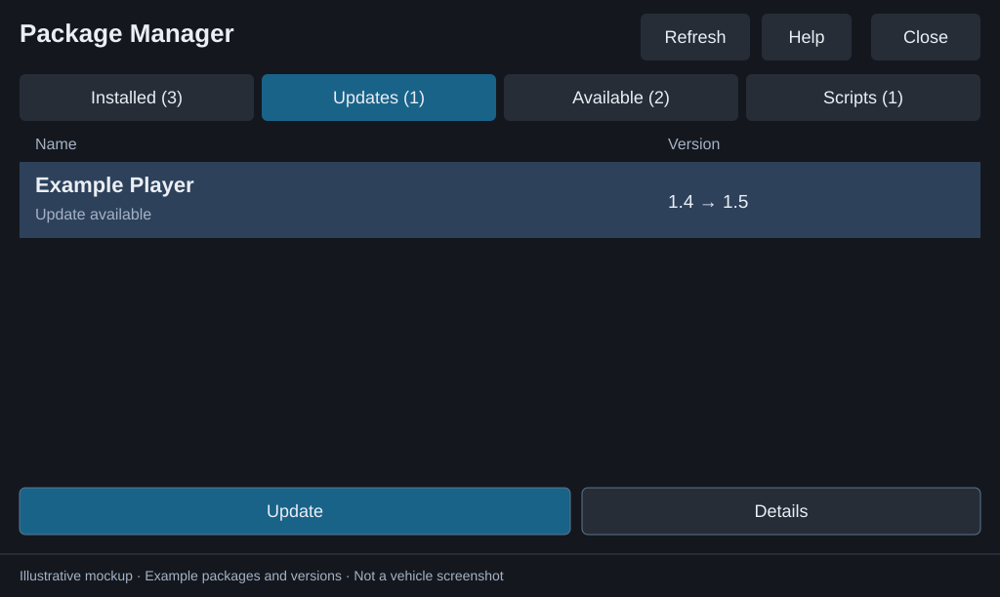

# Updating packages

Package Manager installs the files you put on the drive. It does not check online for new releases, download updates, or resolve dependencies and conflicts. Download the release you want on your PC first and check its compatibility and update instructions.

For a walkthrough with screen examples, follow [Update a community package](USER-GUIDE.md#update-a-community-package). To update Package Manager itself, use [the separate instructions below](#update-package-manager).

The Version column shows the installed release in Installed, the USB release in Available and Scripts, and both versions in Updates. The [action label table](USER-GUIDE.md#update-a-community-package) explains **Update**, **Up to date**, **Older installer**, and **Install version**. If versions cannot be compared, check Details and the release instructions before confirming.

## Update another package



*Screen mockup with fictional package data. The comparison is installed version to USB version; it does not check online. See [confirmation, progress, and result examples](USER-GUIDE.md#confirm-and-wait-for-the-result).*

1. Download the package's new release and read its update instructions. Back up any settings or data its author says an update may replace.
2. On your PC, import the release into the **same folder** used for that package. In the [USB companion](USB-COMPANION.md#use-the-ui), select the drive, click the package's **Replace on USB** action, choose the new release ZIP, and confirm **Update package**. From a source checkout, the equivalent command is:

   ```powershell
   python tools/import_release.py .\downloads\example-new-release.zip --usb E:\ --name Example --overwrite
   ```

   This replaces installer files under `E:\packages\Example\` while preserving its `data\` folder. It only prepares the drive; it does not install anything on the vehicle. Keep the folder name consistent instead of accumulating old installers for the same package.
3. If preparing the drive manually, replace the old installer files and descriptor with the new release's files inside `packages/Example/`. Keep `data/` and any user exports. Do not overwrite the drive's root descriptor. For USB-ready bundles, extract the outer archive but keep the inner package ZIP compressed. See [release layouts](RELEASE-LAYOUTS.md).
4. With the vehicle parked and the head unit running, insert the drive. Open **NEMESIS Manager > Packages > Package Manager > Launch** and tap **Refresh**.
5. Select the package, check its installer version and **Details**, then tap **Update** and confirm. NEMESIS validates the installer and performs the update. There is normally no need to uninstall first.
6. Wait for the result popup. An overlay displays a spinner during installation, updates, uninstallation, and script execution. It indicates activity, not a percentage. Open popup **Details** for the exit code and output, then follow any package-specific restart or setup instructions.

If the action says **Install**, NEMESIS did not report that installer's package ID as installed. Confirm that you selected the right release; matching display names do not establish matching IDs. If there is no installer on the drive, an installed-only entry cannot be updated until you add one. Execute-only scripts use **Run script**, not the package update flow.

## Update Package Manager

Package Manager is excluded from its own package list and cannot install, update, launch, or uninstall itself. Use NEMESIS's normal installer to update it. To remove it, use **NEMESIS Manager > Packages > Package Manager > Uninstall**. Its package ID remains `usb.package.manager` across releases.

The companion's **Drive setup > Update manager** only replaces `manager/usb.package.manager.zip` on your normal package drive. It preserves launcher settings and does not update the app installed on the head unit. Follow the steps below to update the installed app.

Download `usb.package.manager.zip` from the new release and keep it compressed. If you downloaded `usb-package-manager-ready.zip` instead, extract it on your PC and take the ZIP from its `manager/` directory. Prepare a separate update drive with these files at its root:

```text
NEMESIS.data
usb.package.manager.zip
```

The ZIP must be the new internal installer. Put this in `NEMESIS.data`:

```ini
[nemesis]
version=1.0
type=install
path=usb.package.manager.zip
```

Close Package Manager, insert that drive after the head unit has booted, confirm NEMESIS's update prompt, and wait for completion. Launch the updated app through **NEMESIS Manager > Packages > Package Manager > Launch**. Return to your normal package drive afterward. Keep its disabled root descriptor disabled and replace its `manager/usb.package.manager.zip` with the new installer for future setup.

## What is preserved

The importer preserves each package's USB `data/` folder. Package Manager does not erase USB installers or exports when uninstalling a package. This does **not** guarantee preservation of settings or files on the head unit: NEMESIS and the package's install hooks control those. Back up important files and follow the package author's instructions.

Use one operation at a time across both UIs. The manager's busy protection does not lock NEMESIS Manager or commands started elsewhere. An uninstall or failed update is not an automatic rollback mechanism.

## When an update cannot proceed

| Symptom | Next step |
| --- | --- |
| No Update action | Confirm the installer exists in the expected folder, then Refresh. Installed-only entries need an installer; scripts use Run script. |
| Installed state unavailable | Read the NEMESIS error and restore its command channel, then Refresh. Do not treat unknown state as uninstalled. |
| Invalid installer | Open package Details and check the descriptor, referenced ZIP, and release layout. |
| Update failed | Read popup Details and the package history, if saved. Resolve the error before retrying; uninstalling first may discard settings. |
| Manager update appears stuck | Check NEMESIS Manager and its logs. Avoid launching a second installer while the first may still be running. |
| Execution prompt returns | A root execute descriptor is active again. Let the updated launcher disable its own descriptor once, or disable that descriptor manually; updating an installer ZIP alone does not require re-enabling it. |
