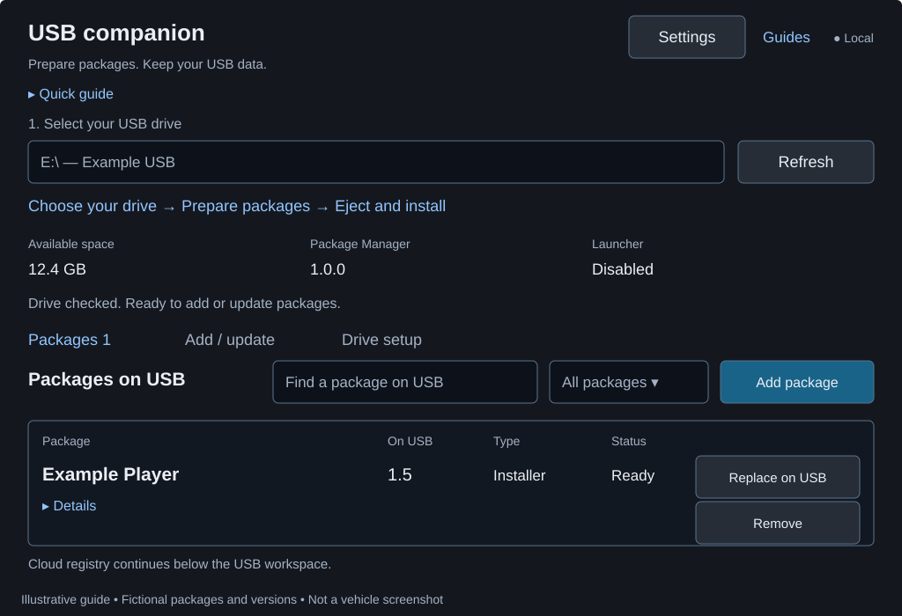

# Local USB companion

The companion opens a local browser UI for preparing a USB drive and managing
the release ZIPs on it. It works offline with downloaded releases and uses only
Python's standard library. There is no frontend framework, Node runtime, account,
database, background service, or cloud dependency.

Start with the [illustrated setup steps](USER-GUIDE.md#get-started) to prepare a drive and install your first package in the vehicle.

## Run a release download

Every new Package Manager release includes both standalone x86-64 builds:

- **Windows:** download `nemesis-usb-companion-windows-x86_64.zip`, extract it,
  and run `nemesis-usb-companion.exe`.
- **Linux:** download `nemesis-usb-companion-linux-x86_64.tar.gz`, extract it,
  and run `./nemesis-usb-companion`. If necessary, first run
  `chmod +x nemesis-usb-companion`.

The executable includes its Python runtime and UI assets. Users do **not** need
to install Python, Node, pip packages, or a separate web server. A browser and the
normal OS libraries are required. Linux builds target glibc-based distributions
compatible with Ubuntu 22.04 or newer; Alpine/musl and ARM are not supported by
these artifacts. Check downloads against the release's `SHA256SUMS` file.

The app opens a local URL automatically and uses a blue, black, and gray dark
theme. Both executables are built and smoke-tested from the same commit as the
head-unit packages. Publication waits for both builds, and checksums cover all
four release downloads. Existing releases are not modified retroactively.

## Run from this repository

Use Python 3.12 or newer. No pip installation is required to run from source.

- **Windows:** double-click `usb-companion.cmd` in the repository root.
- **Linux:** run `sh usb-companion.sh` from the repository root.
- **Either platform:** run `python -m tools.usb_companion` (use `python3` on Linux).

The app selects a free port and opens the browser automatically. Keep its terminal
window open. Press Ctrl+C in that window to stop it. Closing the browser does not
stop the server. To open the browser yourself or choose a port:

```sh
python -m tools.usb_companion --no-browser --port 8765
```

Open the **complete URL** printed in the terminal, including its session fragment.
Only `127.0.0.1` is supported. The fragment authenticates API requests and changes
on each launch. Do not share it with another user or web page.

## Use the UI



*Screen mockup with example drive and package data. **On USB** is the installer version, not the installed head-unit version. See the [illustrated user guide](USER-GUIDE.md#get-started) for the handoff to the vehicle.*

To replace a release, follow the [package update steps](USER-GUIDE.md#update-a-community-package). To update the installed Package Manager app, follow [Update Package Manager](UPDATING.md#update-package-manager).

1. Choose a drive from the **USB drive** selector. **Refresh** checks for
   newly connected media. For USB enclosures reported as fixed disks or unusual
   mounts, open **Drive not listed?** to enter the path. Check the selected path
   and free space. The app does not partition or format drives.
2. In **Drive setup**, choose `usb-package-manager-ready.zip` and click **Set up
   drive**. First setup refuses existing launcher files and disabled backups.
   On a prepared drive, this tab offers **Update manager** instead. Manager updates
   replace only `manager/usb.package.manager.zip`, preserving launcher settings.
   If that installer is missing but launcher files remain, use **Repair manager**
   to restore it without reactivating a disabled launcher.
   These actions only copy the installer to USB; they do not update the installed
   app. After replacement or repair, Drive setup stays open and expands the
   offline NEMESIS installation instructions described below.
3. The **Packages** tab lists names, versions on USB, types, and validation status
   in columns. Use the filter to show installers, scripts, or packages needing
   attention. Expand **Details** for descriptions and file paths, or **View issue**
   for error messages.
4. Click **Add package**, choose a trusted release ZIP, and review its automatically
   generated folder name. **Change folder name** exposes an optional override.
   Click **Add package** to import it. Supported layouts use the shared importer,
   which validates referenced ZIPs and scripts before publishing them.
5. Click a package's **Replace on USB** action, or choose **Update an existing package**
   in **Add / update** and select the package. Choose its new ZIP and confirm
   **Update package**. Existing `data/` directories, including case aliases, are
   preserved. Old installer files are replaced rather than mixed with the new
   release. Changing drives clears pending file selections and update targets.

Replacement requires matching package IDs. If a release has no readable ID
(including scripts without IDs), add it to a new folder instead; the previous
installer and its data remain intact. A drive selection changed in another tab
blocks copying until you refresh and select the intended drive again.

The tabs support arrow keys, Home, and End. Loose ZIP installers remain view-only;
update selectors contain only folders supported by the directory importer.
Hover over a control or focus it with Tab for a short tooltip; Escape dismisses it.
**Quick guide** explains the steps on touchscreens too. After copying, the status
shows what to do next in the vehicle.

Versions labeled **On USB** come from package manifests. They describe installers,
not installed head-unit versions. The USB wrapper's protocol version is not used
as the installer's version. Scripts and missing package versions display as
**Unknown**. Broken
layouts show an error alongside the package instead of disappearing from the list.
Existing raw installer ZIPs directly under `packages/`, or inside a package folder
without a descriptor, are also shown with their internal names and versions.
Loose ZIPs are inspection-only in this UI; import a release into a new managed
folder for future updates. Folders containing a descriptor remain a single package
row, and data-only folders are ignored. Initial setup creates `packages/` even
when no community packages are imported, so the head-unit app can find the drive.
No release downloads, version ordering, firmware compatibility decisions, package
execution, package removal, or vehicle connection are included in this version.

NEMESIS must already work on the head unit. After copying community packages,
use the drive in the parked vehicle and confirm installation or update in
Package Manager. Package Manager itself uses the separate procedure below.

## Install or update Package Manager itself

**Update manager** replaces the installer on USB; **Repair manager** restores a
missing installer. Neither action changes the app installed on the head unit.
Package Manager is hidden from its own list and cannot update itself.

1. Copy `manager/usb.package.manager.zip` from your normal package drive to the
   root of a **separate USB drive**, named `usb.package.manager.zip`. Keep it
   compressed.
2. On that separate drive, create a plain-text file named `NEMESIS.data` at its
   root containing:

   ```ini
   [nemesis]
   version=1.0
   type=install
   path=usb.package.manager.zip
   ```

3. With the vehicle parked and the head unit fully booted, close Package Manager,
   safely eject the separate drive from your computer, and insert it in the
   vehicle. Approve NEMESIS's installation or update prompt, keep the drive
   connected, and wait for completion.
4. Open **NEMESIS Manager > Packages > Package Manager > Launch**. Return to your
   normal package drive afterward, keeping its disabled root descriptor disabled.
   Do not put the install descriptor on that drive.

The same instructions are embedded in **Drive setup**, so no internet connection
is required. For first installation on a newly prepared drive, the normal
launcher can install and open Package Manager after the NEMESIS execution prompt;
that launcher does not update an already-installed copy. See also the
[manager update guide](UPDATING.md#update-package-manager).

## Files and recovery

Uploads are streamed to a temporary file on the computer, with a 512 MiB per-ZIP
limit. Installers are staged on the selected drive before replacement, so the
drive needs enough free space for the new installer. Existing recordings are
moved with directory renames rather than duplicated. Links and junctions in
managed paths are rejected. No package scripts run on the computer.

Ordinary replacement errors attempt to restore the previous package. Abrupt power
loss, process termination, or unplugging during copying is not a transaction-safe
operation. A hidden `.companion-*` directory may remain on the USB; keep it until
you have inspected its `previous/` and `packages/` directories for installers and
user data. If rollback itself fails, the app keeps that directory and reports its
path. Keep independent backups of recordings and exports.

## Build a standalone app

For distribution to users without Python, build the executable **on each target
OS** with PyInstaller. PyInstaller is a build dependency only. The spec bundles
the Python runtime, the shared import helpers, and the three static UI files:

```sh
python -m pip install -r packaging/requirements-companion.txt
python -m PyInstaller --clean --noconfirm packaging/usb-companion.spec
```

The output is `dist/nemesis-usb-companion.exe` on Windows or
`dist/nemesis-usb-companion` on Linux. The terminal stays visible so users can stop
the server and reopen its URL. The executable extracts its bundled runtime to a
temporary directory at startup; it does not install a system service. Linux users
may need to mark the downloaded executable as executable. Build Linux releases on
the oldest supported distribution, then test on the distributions you distribute
to. Native drive discovery and real removable-media behavior require testing on
both operating systems before a release is advertised as validated.

The reusable **USB companion** Actions workflow tests and builds Windows x86-64
and Linux x86-64 artifacts. The main build calls it for PRs and release commits;
it can also be run manually without publishing. Linux builds use Ubuntu 22.04
as their build baseline; they have not been validated on every distribution.

## Development checks

```sh
python -m unittest discover -s tests -p 'test_usb_companion.py'
python -m ruff format --check tools/companion_*.py tools/usb_companion.py tests/test_usb_companion.py
```

Tests use temporary directories and a loopback HTTP server, never real USB media.
