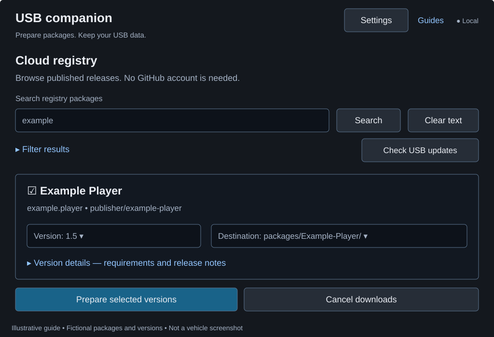

# USB companion guide

Prepare a package drive on your computer, then install the packages in your parked vehicle. The companion can import downloaded ZIPs, prepare published registry releases, replace installers while keeping USB data, and remove files from the drive. **Copying to USB does not install or uninstall anything on the head unit.**

| Task | Go to |
| --- | --- |
| Download and open the companion | [Run a release download](#run-a-release-download) |
| Set up a drive or import a ZIP | [Use the UI](#use-the-ui) |
| Download published releases to USB | [Prepare packages from the registry](#prepare-packages-from-the-registry) |
| Check manager releases or change automatic launch | [Manager release check, automatic launch, and removal](#manager-release-check-automatic-launch-and-removal) |
| Update the installed manager | [Install or update Package Manager itself](#install-or-update-package-manager-itself) |
| Recover after an interrupted copy | [Files and recovery](#files-and-recovery) |

## Run a release download

Get the matching archive from [Releases](https://github.com/hmason55/nemesis-package-manager/releases), then extract it:

| Computer | Download | Run |
| --- | --- | --- |
| Windows x86-64 | `nemesis-usb-companion-windows-x86_64.zip` | `nemesis-usb-companion.exe` |
| Linux x86-64 | `nemesis-usb-companion-linux-x86_64.tar.gz` | `./nemesis-usb-companion` |

The executable includes Python and the UI assets. No Python, Node, pip packages, or separate web server is needed. Linux needs a glibc distribution compatible with Ubuntu 22.04 or newer; Alpine/musl and ARM are unsupported by these downloads. If needed, run `chmod +x nemesis-usb-companion`. Check the archive against the release's `SHA256SUMS`.

The companion opens a browser automatically. Keep its terminal window open; Ctrl+C stops the local server. Closing the browser alone does not stop it. Release artifacts for Windows, Linux, and the head unit come from the same commit. Development prereleases and explicitly published stable releases follow the [release procedures](RELEASING.md).

## Use the UI


*Illustrative screen with fictional packages. **On USB** is the installer version, not the version installed in the vehicle.*

1. Select the USB drive and check its path and available space. **Refresh** discovers newly connected drives. If yours is missing, open **Settings > Drive not listed?**, enter its existing drive or mount path, and select it. The companion does not format drives.
2. For first setup, open **Drive setup**, select `usb-package-manager-ready.zip`, and choose **Set up drive**. On an existing setup, **Update manager** replaces the stored installer; **Repair manager** restores a missing one. Both preserve launcher settings and leave the installed head-unit app unchanged.
3. Open **Packages** to inspect the drive. **Search USB packages** filters immediately; the type filter shows installers, scripts, or **Needs attention**. Open **Details** for paths and descriptions or **View issue** for a layout error.
4. Choose **Add package**, select a trusted release ZIP, and review the suggested folder name. **Change folder name** provides an override. Confirm **Add package** and wait for completion.
5. To replace an installer, choose its **Replace on USB** action, select the new ZIP, and confirm **Update package**. You can also use **Add / update > Update an existing package**. The importer replaces old installer files and preserves the existing USB `data/` folder.
6. Resolve any reported errors, wait for copying to finish, and safely eject the drive. In the vehicle, choose **USB Storage**, tap **Refresh**, and confirm **Install** or **Update**. See the [vehicle walkthrough](USER-GUIDE.md#get-started).

Replacement requires matching internal package IDs. If an ID is unreadable, add the release in a new folder instead. Changing drives clears pending ZIP selections and targets; a change from another browser tab requires you to refresh and select the intended drive again.

Loose installer ZIPs can be inspected and removed, but cannot be replaced in place. Import them into a managed folder for future replacement. Data-only folders are omitted from the package list. **Unknown** means no readable package version; a USB wrapper's protocol version is not the installer version.

The tabs support arrow keys, Home, and End. Hover or focus a control for its tooltip; Escape dismisses it. **Quick guide** also works on touchscreens.

## Prepare packages from the registry



1. Select your USB drive, then scroll to **Cloud registry** below the USB tabs. The built-in staging registry address is ready to use; browsing and downloads need no GitHub account.
2. Type in **Search registry packages**. Results update after a short pause; Enter searches immediately. **Filter results** contains category, publisher, maximum download size, and sort order. **Reset filters** clears these and the search. Size filtering uses each package's latest published ZIP.
3. Select a package to reveal its version and destination controls. Choose the exact version, read the release notes, and expand **Version details** for compatibility information. **Check USB updates** compares releases with installers on the selected drive, not installed head-unit versions.
4. Choose the destination when several managed folders have the same package ID. Review the selections, then choose **Prepare selected versions** and confirm any replacement warnings.
5. Wait for each download, verification, and USB copy. Read every package's result before ejecting; a batch can contain both successes and failures. In the vehicle, use **USB Storage** and confirm installation separately.

The companion verifies publication status, byte size, SHA-256, archive safety, and internal ID/version before importing. **Cancel downloads** stops further work; a directory replacement already in progress finishes. Resolve a failed package's error before retrying it.

In **Settings**, **Registry HTTPS address > Save registry** changes the connection for this companion session. Clear the address and save to disconnect. The optional vehicle, firmware, and NEMESIS profile is saved in this browser; choose **Apply profile and refresh results** after editing it. Compatibility warnings are advisory. Manual imports continue offline. For command-line overrides, use `--registry-url` or `NEMESIS_REGISTRY_URL`; an explicitly empty override disables the default. Startup itself does not contact the registry.

## Manager release check, automatic launch, and removal

**Drive setup** shows the manager installer version on USB and checks public GitHub release metadata, including development prereleases. A newer comparable version offers a release-page link; downloads are explicit. Use **Check for updates** to retry. USB management continues offline.


Open **Settings > Run Package Manager when this USB is inserted** to change automatic launch. First setup launches once by default and then disables its execution descriptor. Enabling this option keeps launch enabled on later insertions; NEMESIS may still ask for approval. Only a recognized manager launcher can be changed.

On **Packages**, choose **Remove**, review the confirmation, then choose **Remove from USB**. **Also delete this package's USB data** starts unchecked. Keeping data leaves it in the original folder for a later import. Loose ZIP removal keeps shared data and sibling installers. The installed vehicle package stays unchanged.


## Install or update Package Manager itself

**Update manager** and **Repair manager** change the USB installer only. Package Manager is hidden from its own package lists and cannot update itself.

1. Copy `manager/usb.package.manager.zip` from the package drive to the root of a **separate USB drive**. Keep it compressed and named `usb.package.manager.zip`.
2. Create a plain-text `NEMESIS.data` at that separate drive's root:

   ```ini
   [nemesis]
   version=1.0
   type=install
   path=usb.package.manager.zip
   ```

3. Safely eject it from your computer. With the vehicle parked and head unit fully booted, close Package Manager, insert the separate drive, and approve NEMESIS's installation/update prompt. Keep it connected until completion.
4. Open **NEMESIS Manager > Packages > Package Manager > Launch**, then return to your normal package drive. Keep that drive's existing launch preference; do not replace its root descriptor with the install descriptor.

These instructions are also available offline in **Drive setup**. A newly prepared normal drive can install and open a missing manager through its first-launch prompt; it does not update an existing installation. See [Updating packages](UPDATING.md#update-package-manager) for more detail.

## Files and recovery

Local ZIP uploads are streamed to temporary computer storage with a 512 MiB per-ZIP limit. Installers are staged on the USB drive before replacement, so leave enough free space for the new installer. Existing USB data is moved with directory renames rather than duplicated. Managed paths reject links and junctions. No package scripts run on the computer.

Ordinary replacement errors attempt to restore the previous package. Unplugging, terminating the process, or losing power during copying can interrupt recovery. Keep any hidden `.companion-*` directory until you have inspected its `previous/` and `packages/` directories for installers and data. A failed rollback reports the retained path. Keep independent backups of important recordings and exports.

## Run from this repository

Use Python 3.12 or newer; runtime pip installation is unnecessary.

- Windows: double-click `usb-companion.cmd`.
- Linux: run `sh usb-companion.sh`.
- Either: run `python -m tools.usb_companion` (`python3` on Linux).

To choose a port without opening the browser:

```sh
python -m tools.usb_companion --no-browser --port 8765
```

Open the complete printed URL, including its session fragment. Only `127.0.0.1` is supported. The fragment authenticates API requests, changes on each launch, and should not be shared.

## Build a standalone app

Build on each target OS with PyInstaller:

```sh
python -m pip install -r packaging/requirements-companion.txt
python -m PyInstaller --clean --noconfirm packaging/usb-companion.spec
```

The spec bundles the runtime, import helpers, and UI assets. Output is `dist/nemesis-usb-companion.exe` on Windows or `dist/nemesis-usb-companion` on Linux. The executable extracts its runtime into a temporary directory and keeps a terminal open for the server URL and shutdown.

The reusable **USB companion** workflow builds and smoke-tests Windows and Linux x86-64 artifacts. Linux uses Ubuntu 22.04 as its baseline. Test native drive discovery and real removable media on each supported OS before advertising validation.

## Development checks

```sh
python -m unittest discover -s tests -p 'test_usb_companion.py'
python -m ruff format --check tools/companion_*.py tools/usb_companion.py tests/test_usb_companion.py
```

Tests use temporary directories and a loopback server, never real USB media. See the [registry guide](REGISTRY-GUIDE.md) for website browsing and publishing, and the [online guides](https://hmason55.github.io/nemesis-package-manager/#guides) for guided walkthroughs.
