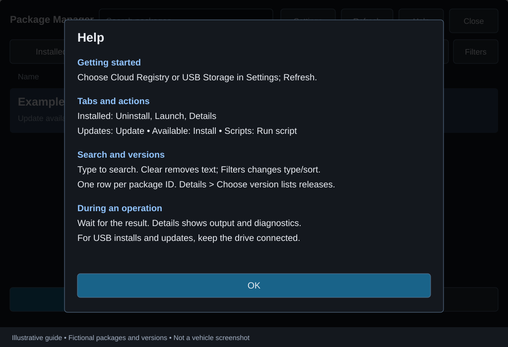
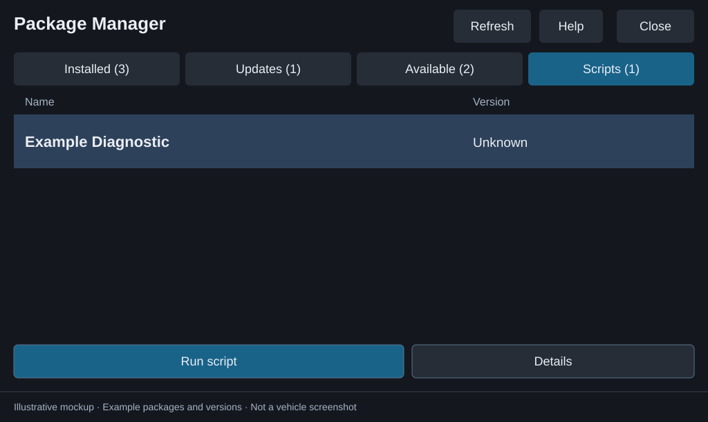
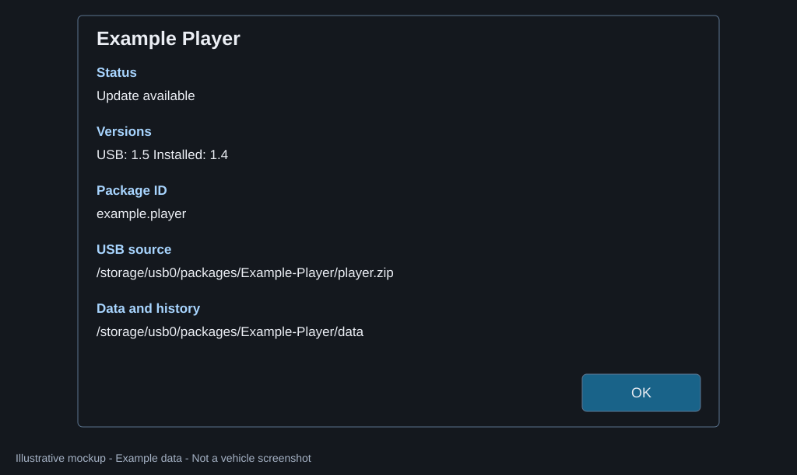
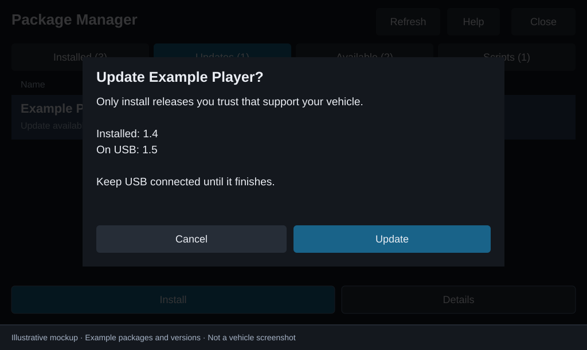
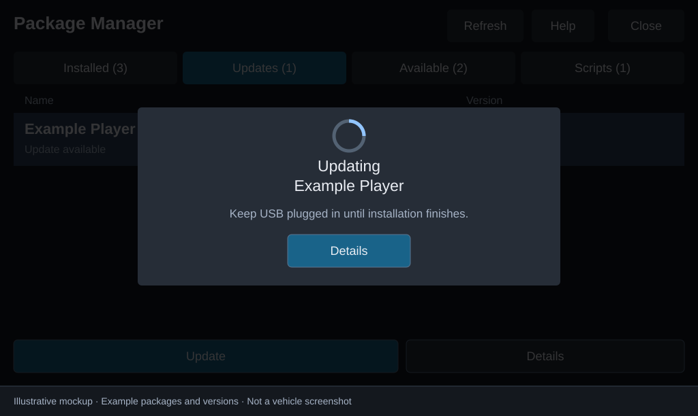
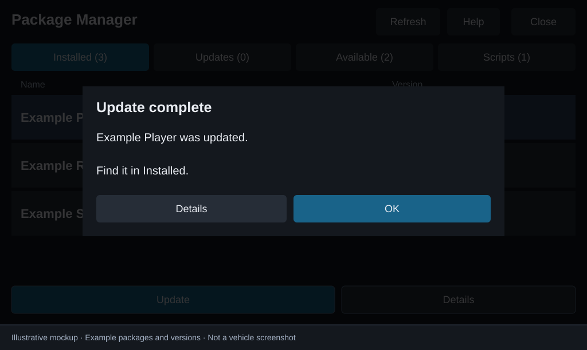
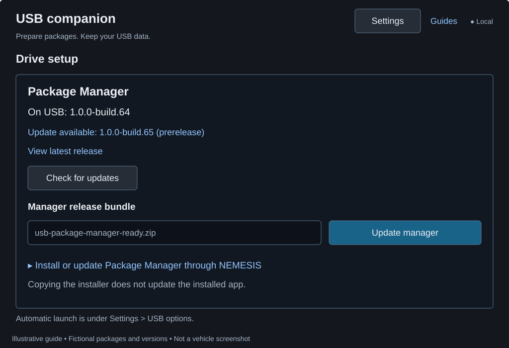
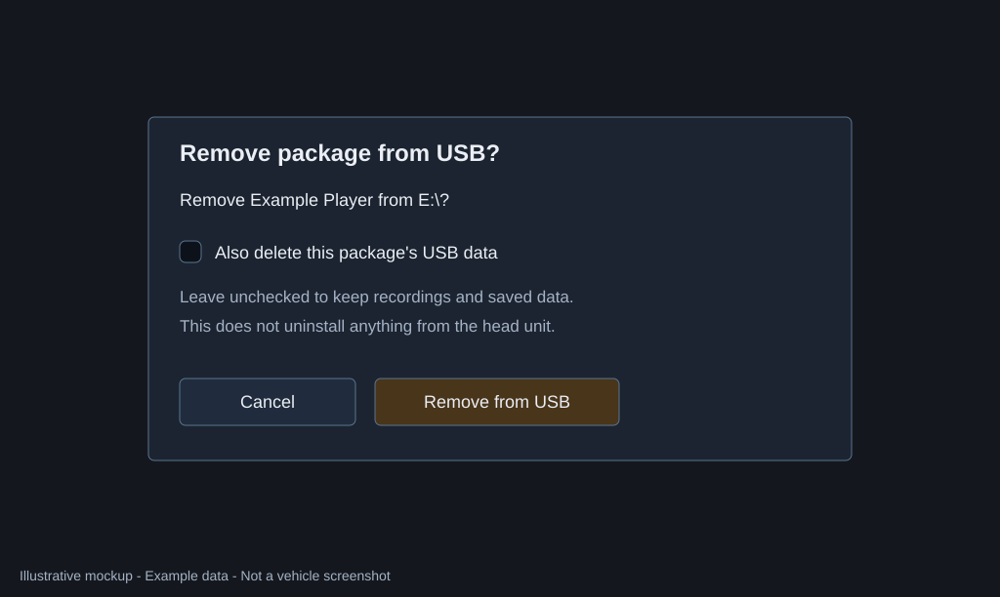

# Package Manager user guide

Use the USB companion on your computer to prepare releases on a drive, then use Package Manager in your parked vehicle to install or run them through NEMESIS. This requires an Android-based Gen5W head unit (`S5W_M`) with NEMESIS already installed and working. The only reported vehicle test is a 2023 Hyundai IONIQ 5 running firmware `260507`; other combinations remain unverified.

Follow the steps beside each screen. The pictures are **illustrative mockups of the current UI**, with fictional package names, versions, and paths. They are not vehicle screenshots or compatibility claims.

| Task | Go to |
| --- | --- |
| Prepare a drive and open the app | [Get started](#get-started) |
| Understand tabs and versions | [Find your way around](#find-your-way-around) |
| Install a downloaded package | [Install a package](#install-a-package) |
| Install a newer release | [Update a community package](#update-a-community-package) |
| Execute a USB task | [Run a script](#run-a-script) |
| Check identity, versions, and paths | [Inspect package details](#inspect-package-details) |
| Understand confirmation and completion | [Confirm and wait for the result](#confirm-and-wait-for-the-result) |
| Open or remove an installed package | [Launch and uninstall](#launch-and-uninstall) |
| Fix a missing package or failed operation | [Troubleshooting](#troubleshooting) |

## Get started

### Prepare the drive on your computer

1. Download `usb-package-manager-ready.zip` and trusted community releases. Read each package's vehicle, firmware, backup, and setup requirements.
2. Download the [standalone USB companion](USB-COMPANION.md#run-a-release-download) for Windows or Linux x86-64. Extract it and run the executable; no Python or Node installation is needed.
3. Select your USB drive and check its path and free space. Under **Drive setup**, choose `usb-package-manager-ready.zip` and confirm **Set up drive**.
4. Under **Add / update**, choose a community release ZIP, review the folder name, and choose **Add package**. Repeat for other releases.
5. Review **Packages** for errors, wait for copying to finish, then safely eject the drive.

*The companion's **On USB** column describes the release on the drive. It cannot tell you which version is installed in the vehicle.*

Prefer to copy files yourself? Follow [manual Windows setup](SETUP-WINDOWS.md#b-prepare-the-drive). The companion handles the folder arrangement for you; you do not need the optional Python tools to use it.

### Open Package Manager in the vehicle

1. With the vehicle parked and the head unit fully booted, insert the drive.
2. Approve the NEMESIS execution prompt. The launcher installs Package Manager if missing, then opens it. It does not install the community packages automatically.
3. Tap **Refresh**, choose a tab, and select a package.

On later visits, open **NEMESIS Manager > Packages > Package Manager > Launch**. After successful first setup, the drive stops prompting to execute at each startup. See [first-launch details](SETUP-WINDOWS.md#c-first-launch) if you are updating an existing drive or still see that prompt.

## Find your way around

**Installed** opens first. **Refresh** reloads the drive and installed packages; **Help** explains the tabs and common actions; **Close** exits the screen. Tap a row to select it, then use the action bar at the bottom. Each tab shows only its applicable actions; unavailable actions within that tab are dimmed.

| Tab | What you find | Version column |
| --- | --- | --- |
| **Installed** | Packages installed on the head unit, including ones without a USB installer | Installed version |
| **Updates** | Installed packages with a confirmed newer installer on this drive | Installed version to USB version, such as `1.4 → 1.5` |
| **Available** | USB installers not reported as installed | USB version |
| **Scripts** | USB tasks you can choose to run | USB version, or Unknown |

A package with an update appears in both **Installed** and **Updates**. **Available** contains packages you have not installed; scripts have their own tab. If the app cannot load installed packages, read the error and tap **Refresh** to retry.

## Install a package

1. Tap **Available** and select the package you want.
2. Tap **Details** to check that it is the intended package and release.
3. Tap **Install**, read the confirmation, and confirm **Install**.
4. Keep USB connected until the result popup. On success, find the package in **Installed**.

*Available shows the USB version. In this example, Example Maps has not been reported as installed on the head unit.*

Only install trusted releases: NEMESIS hooks and scripts run with root privileges. Package Manager does not resolve dependencies or conflicts. Follow the package author's instructions for compatibility and any restart or setup steps.

## Update a community package

On your computer:

1. Download the new release; neither app checks online automatically.
2. In the companion, select the drive and click the package's **Replace on USB** button.
3. Choose the new ZIP and confirm **Update package**. This keeps the package's USB `data/` folder.
4. Wait for copying to finish, then safely eject the drive.

In the parked vehicle:

1. Insert USB, open Package Manager, and tap **Refresh**.
2. Tap **Updates** and select the package.
3. Check **Details**, then tap **Update** and confirm.
4. Keep USB connected until the result popup. Normally there is no need to uninstall first.

| First action | Meaning |
| --- | --- |
| **Uninstall** | Main action on Installed; removes the head-unit package and keeps its USB files |
| **Update** | Main action on Updates, only for a confirmed newer USB installer |
| **Install** | Main action on Available, for packages not installed on the head unit |
| **Run script** | Main action on Scripts |

If a package is installed but its installer is missing from USB, add the release to the drive first. Copying files in the companion does not update the installed app. See [full update instructions](UPDATING.md#update-another-package) for manual copying and help with failures.

Package Manager itself is hidden from these lists. The companion's **Update manager** refreshes its stored USB installer; use [NEMESIS's separate manager update procedure](UPDATING.md#update-package-manager) to update the installed app.

## Run a script

1. Read the script author's instructions; scripts can change the head unit with root privileges.
2. Tap **Scripts**, select the task, and check **Details**.
3. Tap **Run script**, review the confirmation, and confirm.
4. Wait for the result. Running a script does not install an app.

*Unknown means no script release version is available. It is not an update comparison. Launch and Uninstall are dimmed for this script.*

Scripts that assume files are at the USB root may need adaptation by their author before running from a nested folder. The companion does not rewrite or execute them. See [script release layouts](RELEASE-LAYOUTS.md#usb-ready-execution-script).

## Inspect package details

Select a row and tap **Details** to check the installed and USB versions, package ID, source path, and data/history location. Package names can be similar; the ID identifies the installed package. Invalid layouts include an error here.

*Paths vary by package and head unit. An installed-only entry explains that you need to add a compatible USB installer before updating.*

## Confirm and wait for the result

### 1. Check and confirm

Read the confirmation. For an update, it shows both versions. Tap **Cancel** to go back, or tap **Update** to start the example below.

### 2. Wait with USB connected

The busy overlay contains a spinner, the operation and package name, and a blue **Details** button. Installs and updates also say **Keep USB plugged in**. Elapsed time and slow-operation guidance are in Details. Other actions remain blocked until the result is known.

### 3. Read the result

The popup tells you whether the action succeeded. Tap **Details** to read the output or any error, then **OK** to close it. Follow any restart or setup instructions from the package author.

Use one operation at a time across Package Manager and NEMESIS Manager. Both act on the same installed packages; this app's busy protection does not lock the other UI. Refresh after changes made elsewhere.

## Launch and uninstall

Under **Installed**, select a package and choose **Launch** to open it or **Uninstall** to remove it, then confirm. Launch is available only when supported; a service-only package has no launch action.

Uninstalling keeps the USB installer and its package `data/` folder. Package Manager writes operation history there when available; **Details** shows the location. Third-party recordings, exports, and head-unit settings may live elsewhere and follow that app's own rules. Keep independent backups. See [what is preserved](UPDATING.md#what-is-preserved) for more detail.

To remove Package Manager itself, use **NEMESIS Manager > Packages > Package Manager > Uninstall**.

## Troubleshooting

| What you see | Next step |
| --- | --- |
| No packages on USB | Check the selected drive and `packages/` layout, then Refresh |
| Installed state unavailable | Read the error and retry Refresh; do not interpret unknown state as uninstalled |
| No confirmed updates | Copy the intended newer installer to the same package folder, then Refresh; inspect Details for missing or unorderable versions |
| Invalid installer | Open Details and check the referenced files against the [supported layouts](RELEASE-LAYOUTS.md) |
| An operation fails | Read result Details and any saved history; resolve the cause before retrying |
| History could not be saved | Read popup Details and check USB connectivity and write access |
| The execution prompt keeps returning | Check that the launcher successfully disabled its own root descriptor; see [Windows setup](SETUP-WINDOWS.md#data-and-troubleshooting) |

For interrupted computer copies, follow [companion files and recovery](USB-COMPANION.md#files-and-recovery). For installation/update failures, use the [update troubleshooting table](UPDATING.md#when-an-update-cannot-proceed).

## Manage the USB drive on your computer

In **Drive setup**, the companion reads the manager version from the installer on USB and checks published manager releases, including prereleases. A newer comparable release offers a link; nothing is downloaded or installed automatically. **Check for updates** retries a failed/offline check.

Toggle **Run Package Manager when this USB is inserted** to enable or disable its root execution descriptor. NEMESIS may still ask for execution approval. Enabled launch remains enabled on subsequent insertions. The default first-launch setup still disables itself unless this option is enabled.

On **Packages**, choose **Remove**, then decide whether to also delete USB data. Keeping data is the default; adding the same package folder later preserves it. Loose ZIP removal deletes only that ZIP and always keeps shared data. Removal on USB never uninstalls the head-unit package.

Installed versions come from NEMESIS manifests when readable. After a successful installation through Package Manager, it also stores the installed release in private app settings. Details marks a saved fallback version; it can be stale after changes made outside Package Manager. It is cleared after a confirmed uninstall or a successful registry scan that no longer lists that package. Missing metadata for packages never installed through this manager remains Unknown.

## Illustrated online guides

### Find packages as you type

The registry website and Companion update search results as you type. Narrow the registry by category, GitHub publisher, or maximum download size, and sort by package name, publication date, or smallest download. Size refers to the latest published ZIP, not every historical version. Use the clear/reset controls to widen your search. Companion also searches packages already on the selected USB drive without contacting the registry.

In the vehicle, the browser's **Search packages** field filters the current tab. Cloud browsing refreshes after a short pause; **Installed** remains available offline. **Filters** offers package type and sort order, while **Clear** resets search text. Compatibility declarations remain advisory and do not hide or block packages.

Open [NEMESIS user and publisher guides](https://hmason55.github.io/nemesis-package-manager/#guides) for vehicle Settings/source choice, manual and registry USB preparation, compatibility warnings, and GitHub publisher onboarding. The hosted guides include labeled example illustrations and recovery steps. Package Manager itself retains its dedicated update workflow.

### Registry connection and publication

Companion has a built-in staging registry address, so Cloud registry browsing needs
no connection setup or account by default. Settings → Registry HTTPS address → Save registry can override it;
manual USB imports remain available offline. Publishers sign in with GitHub and
connect their public repository/App installation. Successful trusted validation
publishes their release automatically; there is no separate maintainer approval.
Failed validation remains private, and administrators can withdraw broken or abusive
releases. See the hosted publisher guide for the complete workflow.
