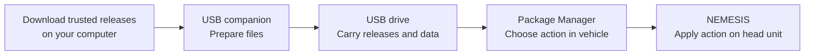
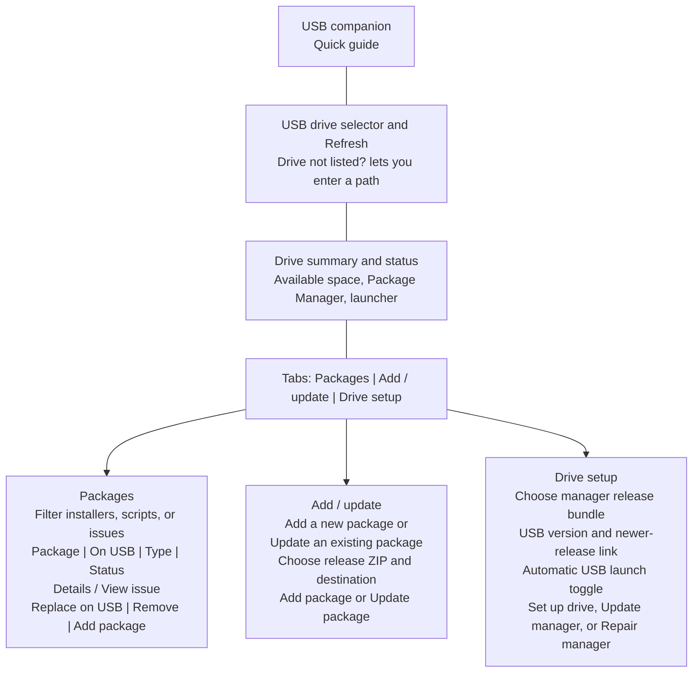
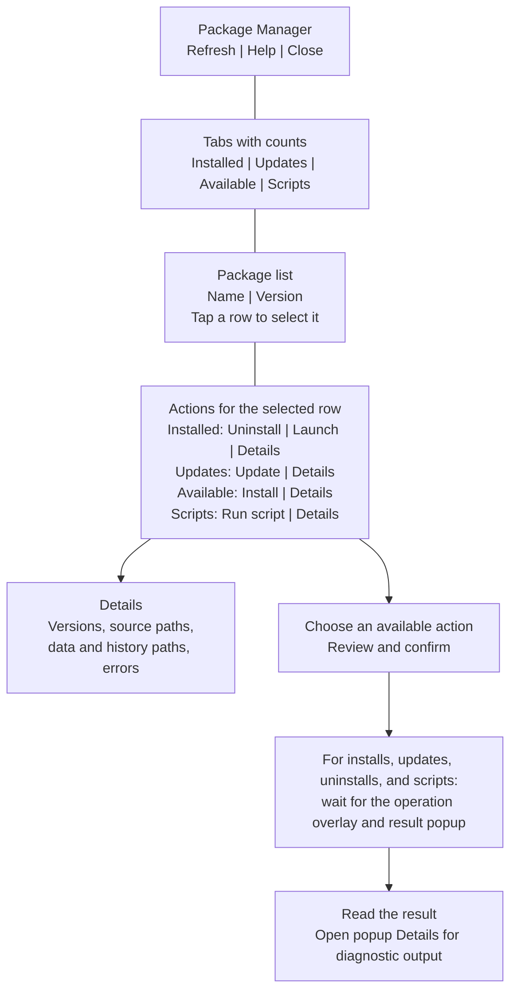
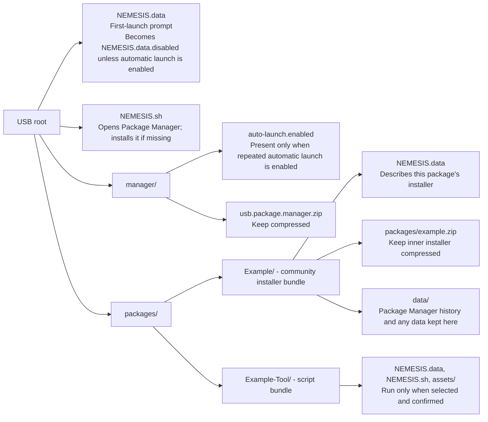
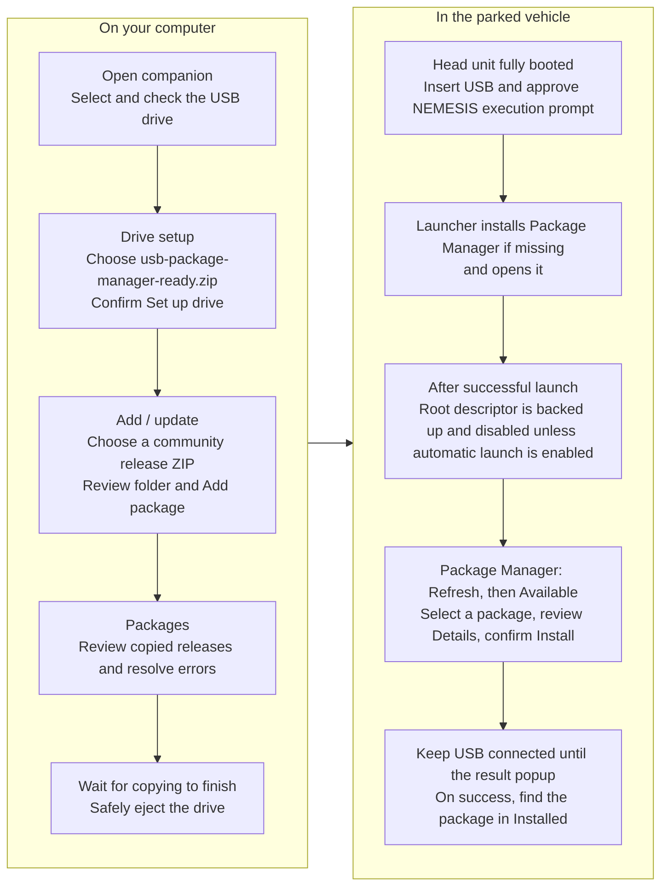
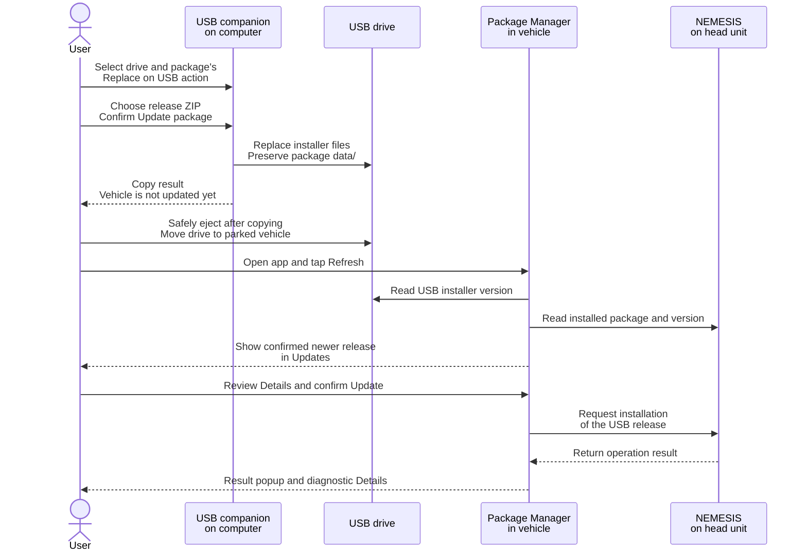
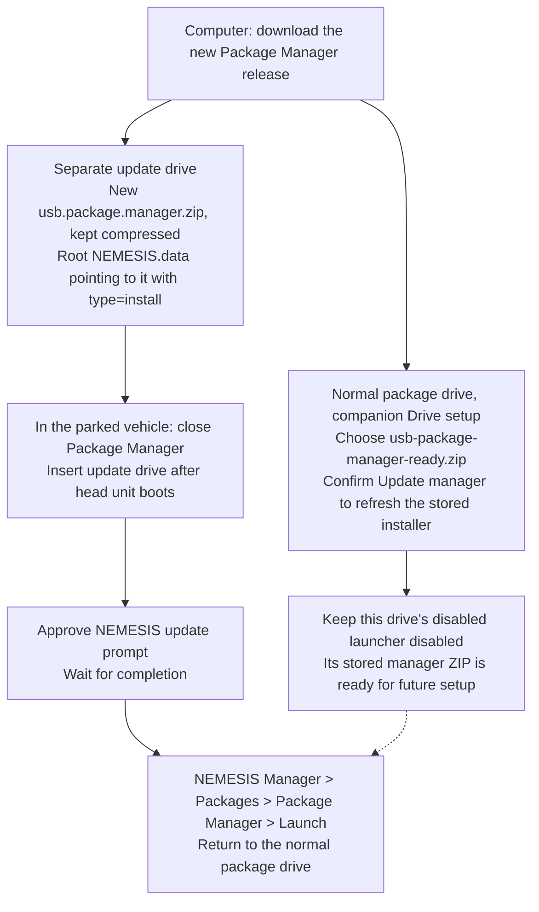
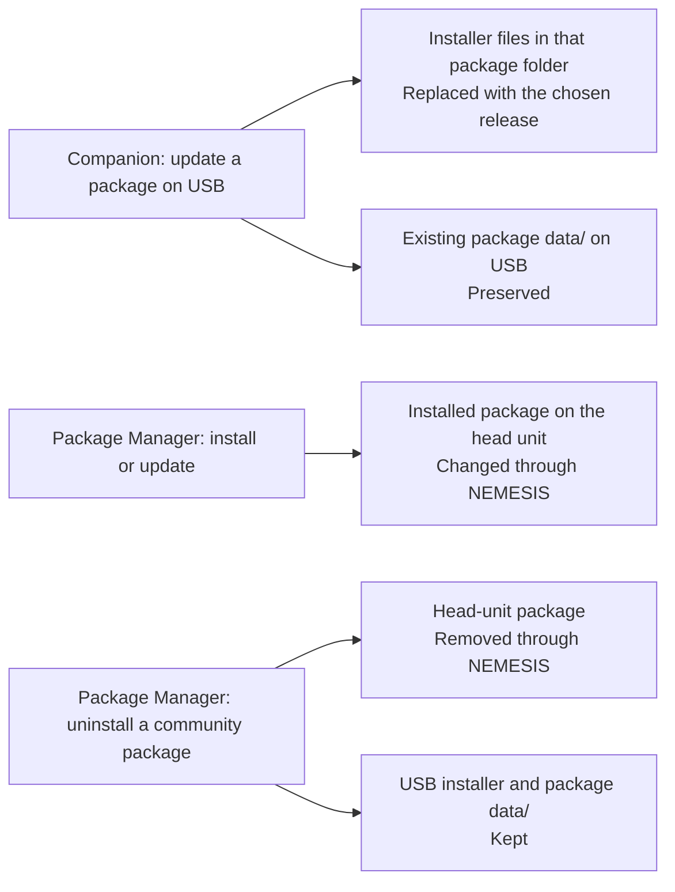
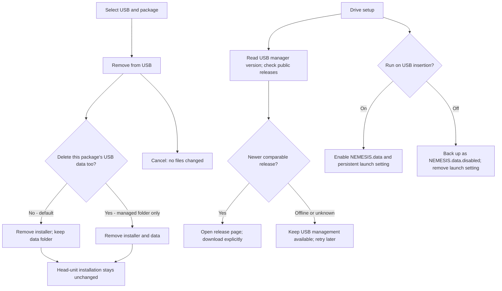

# Detailed workflow reference

This optional reference collects the detailed Mermaid diagrams for the two apps, their screen organization, USB files, and update handoffs. Start with the [illustrated user guide](USER-GUIDE.md) for numbered instructions and screen examples.

Screen maps group controls by purpose and follow their order from top to bottom; they are not exact screenshots. Arrows in a screen map show navigation or reading order, not automatic actions. These diagrams describe workflows and file organization; they are not code architecture diagrams.

## Overall handoff

| Reference topic | Diagram and explanation |
| --- | --- |
| Find a control on the computer | [Companion screen](#companion-screen) |
| Find a package or action in the vehicle | [Package Manager screen](#package-manager-screen) |
| Understand which files go where | [USB drive layout](#usb-drive-layout) |
| Prepare a drive and install your first package | [First use](#first-use) |
| Replace a community package with a newer release | [Community package updates](#community-package-updates) |
| Update Package Manager itself | [Package Manager updates](#package-manager-updates) |
| Understand what happens to installers and data | [Installers and data](#installers-and-data) |

## Companion screen

Open the companion on your computer with the USB drive connected. Select the drive before choosing a task; check its path and available space so you know where files will be copied.

- **Packages** answers “what is on this drive?” **On USB** is the installer's version, not the version installed in the vehicle. **Needs attention** helps find layout errors; expand **View issue** to read them, or **Details** for other package information. **Replace on USB** opens the update form for a managed package.
- **Add / update** imports a downloaded release ZIP into a package folder. When adding, review the suggested folder name. When updating, choose the existing package so its old installer is replaced and its USB `data/` is kept.
- **Drive setup** takes `usb-package-manager-ready.zip`. A new drive offers **Set up drive**; an existing setup offers **Update manager**, or **Repair manager** if the installer is missing and the setup can be repaired. These actions prepare the USB copy; they do not update the app installed in the vehicle.

Loose installer ZIPs can be inspected and removed, but not replaced in place. Import a release into a managed folder for future companion updates. The companion does not format the drive, run package scripts or connect to the vehicle. See the [companion guide](USB-COMPANION.md#use-the-ui) for the full steps and supported downloads.

## Package Manager screen

After first setup, open **NEMESIS Manager > Packages > Package Manager > Launch**. Insert your package drive and tap **Refresh** to read its files and the head unit's installed packages.

| Tab | What you find | What Version means |
| --- | --- | --- |
| **Installed** (opens first) | Packages installed on the head unit, including ones without an installer on this drive | Installed version |
| **Updates** | Installed packages with a confirmed newer installer on USB | Installed version to USB version, such as `0.5 -> 0.6` |
| **Available** | USB installers whose package IDs are not reported as installed | USB version |
| **Scripts** | USB tasks you can explicitly choose to run | USB version, or Unknown when absent |

A package with a confirmed update appears in both **Installed** and **Updates**, not **Available**. **Updates** checks the files on your drive; it does not search online. If installed-state detection fails, read the error and tap **Refresh** to retry before interpreting the categories.

Only the actions for the active tab are shown. Installed leads with a yellow **Uninstall** button plus **Launch** and **Details**; Updates has **Update**, Available has **Install**, and Scripts has **Run script**, each with Details. Missing or unorderable versions do not enable a blind installation from Installed.

The overlay indicates activity, not percentage complete. Keep USB plugged in during installs and updates; wait for every action's result. Finish one operation before starting another in either Package Manager or NEMESIS Manager. Package Manager itself is excluded from these lists; see [its separate update path](#package-manager-updates).

## USB drive layout

Keep the manager's launcher at the root and each community release in its own folder under `packages/`. This lets one drive hold several installers and scripts without replacing the root launcher for each package.

The diagram shows example USB-ready layouts; actual inner filenames vary. Extract the outer release bundle into its package folder while leaving the inner installer ZIP compressed. When importing a raw internal installer ZIP into a managed folder, the companion/importer creates a folder-local wrapper for you. Community descriptors stay inside their package folders, not at the USB root. See [supported release layouts](RELEASE-LAYOUTS.md) for the other accepted forms and script limitations.

## First use

Download the standalone companion for your computer, `usb-package-manager-ready.zip`, and the trusted community releases you want. Check each package's vehicle and firmware requirements. The companion is optional; manual preparation and the source-checkout tools lead to the same in-vehicle steps.

The first execution prompt starts the manager launcher; it does not install every community package. Choose and confirm those separately. Scripts are under **Scripts** and use **Run script** instead of installation.

On later visits, open **NEMESIS Manager > Packages > Package Manager > Launch**. The disabled root descriptor prevents the normal package drive from prompting to execute on each startup. If Package Manager is already installed, the launcher opens it; replacing the manager ZIP does not update the installed app. See the [setup guide](SETUP-WINDOWS.md) for detailed preparation and troubleshooting.

## Community package updates

Updating has two separate steps: replace the installer on USB, then install that release in the vehicle. Choose the same package folder to preserve its USB `data/` and avoid keeping several old installers for the same package.

This diagram follows a compatible release with a confirmed newer version. Missing or unorderable versions do not appear in Updates; check **Details** and the release instructions. If you see **Install**, check that you chose the correct package ID. A successful copy in the companion is not evidence of a successful head-unit update.

There is normally no need to uninstall first. Follow the author's backup and restart instructions, and inspect result **Details** if an update fails. See [Updating packages](UPDATING.md#update-another-package) for manual/command-line preparation, version rules, and recovery steps.

## Package Manager updates

Package Manager cannot manage itself. The companion's **Update manager** replaces the installer stored on your normal USB drive and keeps launcher settings; it does not cause the installed app to update on the next launch. Use NEMESIS's installer explicitly for the head-unit update.

Refreshing the stored installer and updating the installed app are separate tasks; either order is possible. The separate update drive uses an **install** descriptor, unlike the normal drive's first-launch **execute** descriptor. For the exact descriptor contents and filenames, follow [Update Package Manager](UPDATING.md#update-package-manager). Uninstall Package Manager through **NEMESIS Manager > Packages > Package Manager > Uninstall**.

## Installers and data

The USB installer, the installed head-unit package, and files saved by an app are separate things. Keeping one does not guarantee a backup of the others.

Package Manager saves operation history under the package's `data/` when available; **Details** gives the location. Third-party recordings, exports, and settings may live elsewhere. Neither app redirects those files or guarantees that package install hooks preserve head-unit settings. Keep independent backups and follow the package author's instructions.

If copying is interrupted, do not delete leftover hidden `.companion-*` directories until you have checked them for previous installers and data. See [companion files and recovery](USB-COMPANION.md#files-and-recovery) and [what updates preserve](UPDATING.md#what-is-preserved).

## Version comparison notes

Package Manager reads installed versions from `/data/nemesis/apps/<id>/NEMESIS.data` through NEMESIS using a fixed-length command that fits its command buffer regardless of package count. Numeric versions display without a leading `v`. Numeric dotted releases and numeric `-build.N` suffixes are compared numerically; older installers are disabled. Identical custom version strings are recognized as equal. A successful install also saves a fallback version in private app settings. Manifest metadata takes precedence; saved fallbacks are labeled in Details and may be stale after external changes. Missing or unorderable versions do not claim an update is available.

## Companion removal and launch preference

